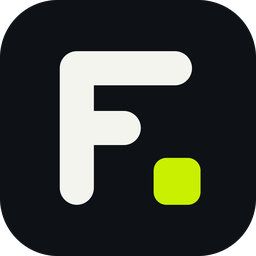

<p align="center">
  
</p>

<h1 align="center">Frejmo Edit</h1>

<p align="center">Video editor u browseru sa lokalnim Python exportom preko ffmpeg-a.</p>

---

## Šta je ovo

Editor (tajmlajn, efekti, titlovi, pregled) radi u browseru, ali se **export više ne radi u browseru**. Browser samo nacrta svaki kadar i pošalje ga lokalnom Python serveru, a ovaj ga prosleđuje ffmpeg-u koji kodira video i upisuje fajl direktno na disk.

Zbog toga:

- H.264 radi na svakoj rezoluciji (i 8K), bez WebCodecs ograničenja
- nema ffmpeg.wasm konverzije
- nema "0 KB" fajlova zbog nedostatka memorije u browseru
- ostali izvozi (sličica, `.srt`, chapters, projekat `.json`) otvaraju pravi sistemski dijalog "Sačuvaj kao"

Server radi samo na tvom računaru (`127.0.0.1`), a svaki zahtev traži nasumični token.

## Potrebno

- Python 3.8+
- ffmpeg. Ako ga nemaš, program nudi da sam instalira paket `imageio-ffmpeg` (sadrži gotov ffmpeg), ili ga instaliraj ručno sa https://ffmpeg.org/download.html

## Pokretanje

```bash
python frejmo_edit.py
```

Na Windowsu možeš i dvoklikom na `POKRENI.bat`. Editor se otvara u browseru na `http://127.0.0.1:8765/`.

> **Važno:** pored `frejmo_edit.py` mora da stoji fajl editora `frejmo_edit.html`
> (stariji naziv `cadria_edit.html` se takođe prepoznaje). Bez njega se program ne pokreće.

## Opcije

| Opcija | Opis |
|---|---|
| `--port 8765` | port lokalnog servera (ako je zauzet, probaju se sledećih 20) |
| `--out FOLDER` | podrazumevani folder za izvoz |
| `--no-browser` | ne otvaraj browser automatski |
| `--ffmpeg PUTANJA` | tačna putanja do ffmpeg programa |
| `--hw {auto,off,nvenc,qsv,amf,videotoolbox}` | hardverski enkoder; podrazumevano `off` (softverski, najbolji kvalitet). Svaki se prvo proba i ako ne radi, koristi se softverski |
| `--max-jobs N` | najviše istovremenih exporta (podrazumevano 2) |
| `--idle-timeout S` | posle koliko sekundi neaktivnosti se napušten export otkazuje (podrazumevano 300) |

## Formati

| Kontejner | Video | Zvuk |
|---|---|---|
| MP4 | H.264 (ili H.265 u režimu `maxres`) | AAC |
| WebM | VP9 | Opus |

Boje se označavaju kao BT.709, dimenzije se zaokružuju na parne, a MP4 se piše sa `+faststart`.

## API koji koristi editor

Svi pozivi su `POST` i traže zaglavlje `X-Frejmo-Token` (ili staro `X-Cadria-Token`).
Token editor dobija kroz `window.FREJMO_PY` (ili staro `window.CADRIA_PY`).

| Putanja | Namena |
|---|---|
| `/api/info` | podaci o ffmpeg-u i dostupnim enkoderima |
| `/api/export/start` | pokreće export (širina, visina, fps, kontejner, bitrate...) |
| `/api/export/<id>/audio` | šalje zvuk (`f32le`, stereo) pre prvog kadra |
| `/api/export/<id>/frame` | šalje jedan sirov kadar (`rgba` ili `rgb24`) |
| `/api/export/<id>/status` | broj kadrova, brzina, enkoder |
| `/api/export/<id>/finish` | završava export |
| `/api/export/<id>/abort` | otkazuje export i briše privremene fajlove |
| `/api/save` | snima običan fajl (`.png`, `.jpg`, `.srt`, `.vtt`, `.json`, `.txt`, `.csv`, `.mp4`, `.webm`) |

Dodatni opcioni parametri za `start`: `frameFormat` (`rgba` ili `rgb24`), `rateMode` (`capped-crf` ili `bitrate`), `hw`.

## Struktura

```
frejmo_edit.py     server + ffmpeg export
frejmo_edit.html   editor (dodaj ga ovde)
POKRENI.bat        pokretanje na Windowsu
assets/            logo i ikone (SVG, PNG, ICO)
```

Log se piše u `frejmo_edit.log` pored programa.
